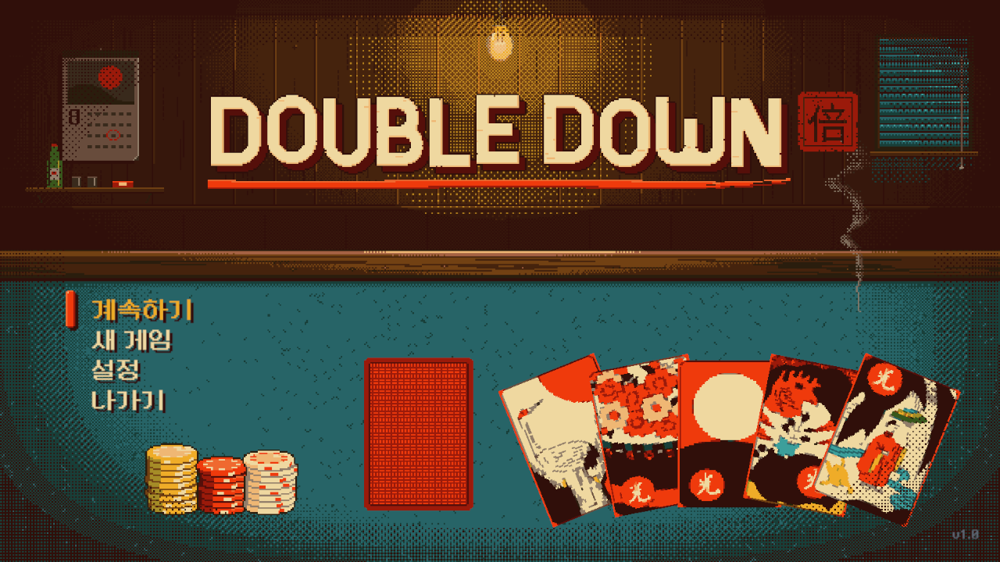

[← 목록](../README.md)

# 타이틀 씬 제작 + 계속하기(런 저장) 계획

## Context

타이틀 그림 13장이 `Assets/Arts/Sprites/Title/`에 임포트됐다(Double Down `8901b4c`). 지금 타이틀은 단색 배경과 금색 명판, 버튼 셋뿐이다.
이 그림으로 장면을 세우고, 메뉴에 **계속하기**를 더한다. 계속하기는 저장된 게임이 있을 때만 보인다.

조사 결과 **런 저장은 지금 전혀 없다**(`MatchSceneInstaller.cs:50` "저장·이어하기는 아직 없다"). 계속하기는 저장 기능을 새로 세우는 일이다.
사용자 결정(2026-11-06): 저장 방식은 슬레이 더 스파이어를 따른다. 저장이 있을 때 새 게임을 누르면 별도 확인 창을 띄운다. 추가 범위는 없다.

## 1. 슬레이 더 스파이어 저장 방식과 대응

| StS | 근거 | Double Down 대응 |
|---|---|---|
| 방에 들어갈 때 자동 저장(층 증가 → 저장) | gist(luckytyphlosion) | **판 시작 체크포인트**: `CreateNext` 직전 |
| 전투 승리 직후, 보상 화면 전에 저장(`post_combat`) → 다시 열면 같은 보상 화면 | gist, Steam 토론 | **상점 체크포인트**: `ReportMatchEnded`가 true를 낸 직후. 재개하면 요약 없이 같은 상점이 열린다 |
| 전투 도중 종료 → 그 전투를 1턴부터 다시. 패가 같다(전투 난수 = 시드 + 층) | Steam 토론, oohbleh | 판 도중 종료 → 그 판을 처음부터 같은 상대·같은 분배로. 판 난수는 (루트, 상대, 판 번호, 라운드)에서 파생된다(`MatchFlow.cs:509-524`) |
| 난수마다 카운터를 저장해 다시 굴리기를 막는다 | gist, libsts | 저장할 난수 위치는 `_nextMatchIndex` 하나다. 상점·상대 선택 스트림이 모두 이 값에서 파생된다 |
| 버그: 저장 안 한 제단 목록, 하나 어긋난 카운터 → 다시 열면 결과가 바뀜 | gist | 같은 함정: `MetOpponentLedger`(이번 막에 만난 상대)를 빼면 상대가 바뀐다. 캡처를 지수 증가 뒤에 하면 다음 판으로 밀린다. 둘 다 뮤테이션 시험으로 지킨다 |
| JSON 한 파일(base64 + XOR 난독화) | libsts `save.rs` | JSON 한 파일. 난독화는 하지 않는다(싱글 플레이 개발 단계) |
| 메인 메뉴에 계속하기, 런이 끝나면 저장 삭제 | 커뮤니티 설명(공식 문서 미확인) | 런이 끝나는 순간(`ReportMatchEnded` false) 삭제 |

**상점 도중에는 저장하지 않는다.** 매대 추첨이 장착한 보너스 카드에 의존하므로(`ShopSession.cs:284-292`), 구매 뒤 저장하고 상점을 다시 만들면 매대가 다시 뽑힌다.
상점에서 사고 끄면 구매 전으로 돌아가지만 매대는 같다.

## 2. 설계

### 2-1. 저장 소유와 계층

| 계층 | 새 것 | 내용 |
|---|---|---|
| Domain | `Run/RunSnapshot.cs`, `RunResumePoint {Match=1, Shop=2}`, `RunFlow.Restore(...)` | 스키마 판본, 시드 코드, 덱 id, `NextMatchIndex`, 재개 지점, RunFlow(Chips·Gold·Act·SlotIndex·MatchesWon·StakeRuleEnabled), 각서 횟수, 작업패 단 수, 보너스 카드(순서 = 발화 순서), 도장(칸 순서대로 카드 원형 id + 도장 stable id), 만난 상대 명부(막, id들), 진단용 판본. `Phase`는 저장하지 않고 복원 때 `AwaitingMatch`를 단언한다 |
| Boot | `MatchSessionFactory.CaptureSnapshot(point)`, `static FromSnapshot(...)`, 명부 노출 | 모르는 id는 기존 `Raise`·`Equip`·`Stamp` 검증이 던진다. 검증 지점은 여기 하나 |
| Application | `IRunSaveStore`(TryLoad·Save·Delete) | 포트가 필수인 근거는 asmdef다. `Boot.Scenes`가 Infrastructure를 참조하지 않는다 |
| Infrastructure | `Save/FileRunSaveStore.cs` | `[Serializable]` DTO + `JsonUtility`, 임시 파일에 쓰고 교체(원자적), 스키마 판본이 다르거나 손상되면 "저장 없음" + 경고. 데이터 판본(BG DB 해시) 차이는 경고만 하고 불러온다 |
| Boot | `RunCheckpoint.cs`(씬 스코프 POCO) | `CreateNext`와 `ReportMatchEnded`를 감싸 Save·Delete를 독점한다 |

체크포인트를 공장 안에 넣지 않는 이유: 공장 생성자를 부르는 곳이 시험 21곳이고, `BombDebugMode`(`BombDebugMode.cs:93-94`)가 탐침으로 공장을 반복 생성해 실제 세이브를 덮어쓴다. MainScene 호출부에 직접 두면 시험할 수 없다(MainScene은 자동 시험이 없다).

Easy Save 3는 설치돼 있지만 쓰지 않는다. asmdef가 없어 `DoubleDown.*` 어셈블리에서 참조할 수 없고, 서드파티 폴더에 asmdef를 더하는 비용이 `JsonUtility`보다 크다.

### 2-2. 재개 경로

- `PendingRunConfig.SetResume(snapshot)`이 스냅샷에서 `RunConfig`(시드·덱)를 파생한다. `Set()`·`Reset()`은 재개 표시를 지운다. 인스톨러는 `TakeResume()`으로 한 번만 꺼낸다.
- `MatchSceneInstaller`: 재개면 `FromSnapshot`, 아니면 `ForNewRun`. 재개일 때 BombDebugMode 시드 덮어쓰기(`:65-78`)를 건너뛴다. `FromSnapshot`이 던지면 LogError → 세이브 삭제 → 같은 RunConfig로 `ForNewRun`.
- 상점 재개: 첫 `CreateNext`가 로드 스텝 `PrepareMatchAsync`(`MainScene.cs:368`)에서 불리므로, 상점 재개 때는 그 `BuildRuntime`을 건너뛴다. 진입 훅에서 HUD 칩·슬롯을 한 번 밀고(`ShowRunChips`·`ShowBonusSlots`, 상점 콜백은 값이 바뀔 때만 불린다) 상점을 연 뒤 판을 세운다. `StartNewMatchAsync`는 `_runtime == null`이면 판을 새로 세운다(`:283-286`).
- 런이 끝나면 삭제한다. 패배 후 타이틀을 고르면 계속하기가 사라진다. 다시 하기와 클리어 후 자동 새 런은 그 런의 첫 `CreateNext`에서 다시 저장된다.

### 2-3. 타이틀 화면

- **배경은 월드 공간 SpriteRenderer**로 세운다(판 화면과 같은 방식). 카메라는 직교 크기 1.8, 중심 (3.2, −1.8)이라 1080p에서 정확히 ×3이다. 임포터의 모델 프리팹은 쓰지 않는다. 여러 프레임 파일에 Animator와 반복 클립이 자동으로 붙어, 도장 1회·램프 느린 깜빡임과 맞지 않는다. 피벗이 캔버스 하단 가운데라 임포터가 여백을 잘라도 자리는 그대로다.
- 층 순서: 방 → 테이블 → 뒷면 더미 → 칩 3 → 화투 부채 5 → 빛무리 → 전구 → 연기 → 비네트 → 로고 → 도장. 자리는 `Guides~/_generator/bake.py` `PLACE`와 승인된 합성(`Title_Screen_preview_x3.png`)을 따른다. 부제("화투 로그라이크 · 하우스에 앉는다")도 합성대로 넣는다.
- 움직임: 연기 12프레임 0.12초 반복, 도장은 진입 때 1회, 전구는 빛무리 알파 ±3%로 숨 쉬고 가끔 어두운 프레임. 프레임 진행은 `Advance(dt)` 순수 계산으로 둬 시험한다. 반복은 기존 선례(Update + sin, `HudRejectionFeedback.cs:88`)를 따른다.
- **메뉴는 uGUI 오버레이**이고 캔버스 가운데에 앵커를 둔다. 월드와 UI가 둘 다 높이 맞춤이라 어느 화면비에서도 같이 움직인다. 글자 48px(16px × 3), 간격 58, 아래 정렬. 항목은 계속하기 · 새 게임 · 설정 · 나가기. 계속하기를 숨겨도 나머지는 움직이지 않는다. 마지막 항목 아래 끝(y 794)이 칩 위 끝(804)보다 위다.
- 커서(`Title_Cursor`)는 선택된 항목 왼쪽. 첫 선택은 계속하기가 보이면 계속하기, 아니면 새 게임. 호버·선택 1.03배, 누름 0.97배(LitMotion, `MotionHandle` 보관·`TryCancel`).
- 옛 `Image_Backdrop`·`Panel_TitlePlaque`(`Text_Title` 포함)는 지운다. 씬 굽기 도구는 `AgentScripts/BakeTitleScreen.cs` 하나로 유지한다(두 도구가 한 씬을 다투지 않게).
- 확인 창 `TitleConfirmView`: "새 게임을 시작하면 진행 중인 게임이 지워집니다." [계속][취소], 기본 포커스는 취소. 확인하면 런 설정 창이 열리고, **세이브는 시작을 누를 때 지운다**. 런 설정에서 취소하면 세이브가 남는다.

## 3. 구현 카드 (카드마다 커밋 1)

카드마다 재컴파일 → 라이브 픽스처 → 배치 전량(`ddtest.sh` + PlayMode) → 뮤테이션 ≥ 1 → 커밋. 구현과 시험은 다른 에이전트다.

| 카드 | 구현/시험 | 편집 | 시험 | 뮤테이션 → 빨간불 | 게이트 |
|---|---|---|---|---|---|
| **C1** 스냅샷 | Jarvis / Sonny | `Domain/Run/RunSnapshot.cs`, `RunFlow.cs`(`Restore`) | EditMode: 범위 검증(막·슬롯·칩·골드), 왕복 | 슬롯 범위 검증 제거 | `RunFlow.Restore(` 생산자 표 |
| **C2** 공장 캡처·복원 | Jarvis / Sonny | `Boot/MatchSessionFactory.cs`(`CaptureSnapshot`·`FromSnapshot`·명부) | 통합: ① 판 재개 = 같은 상대 + 같은 첫 분배 ② 승리 뒤 상점 재개 = 같은 매대 ③ 2슬롯 뒤 재개해도 상대 비중복 | 명부 복원 생략 → ③, 지수 증가 뒤 캡처 → ① | `StartNewRun`이 갈아 끼우는 필드가 Capture·From 양쪽에 모두 있다 |
| **C3** 저장소 | Jarvis / Sonny | `Application/IRunSaveStore.cs`, `Infrastructure/Save/FileRunSaveStore.cs`, `Boot/ProjectInstaller.cs` | Infrastructure EditMode(임시 폴더): 왕복, 손상, 스키마 불일치, 보너스 순서, 없는 파일 | 보너스 정렬 저장 | `persistentDataPath`가 ProjectInstaller에만 |
| **C4** 체크포인트·재개 통로 | Jarvis / Sonny | `Boot/RunCheckpoint.cs`, `Boot/RunConfig.cs`(Resume), `Boot/MatchSceneInstaller.cs` | 통합(가짜 저장소): 판 시작 저장 지수 N, 상점 저장, 패배·클리어 삭제, 복원 실패 폴백 | 저장을 `CreateNext` 뒤로 | `IRunSaveStore` 사용처 표 |
| **C5** MainScene 배선 | Jarvis / Sonny | `Boot/Scenes/MainScene.cs`(호출부 2곳, 로드 스텝 건너뛰기, 상점 먼저, HUD 밀기) | 라이브 탐침 캡처(MainScene은 자동 시험 없음) | 건너뛰기 제거 → 탐침이 매대 불일치를 잡는다 | `_sessionFactory.(CreateNext\|ReportMatchEnded)` Boot/Scenes 0건 |
| **C6** 타이틀 장면 | Ava / Sonny | `AgentScripts/BakeTitleScreen.cs`(그림 층·카메라·옛 객체 제거·부제), `Presentation/Title/TitleSpriteFlipbook.cs`, `TitleLampFlicker.cs` | EditMode: `Advance(dt)` 반복·1회·깜빡임 | 1회 모드가 순환 | TitleScene.unity `Animator` 0건, 굽기 2회째 변경 0 |
| **C7** 메뉴 | Ava / Sonny | `Presentation/Title/TitleView.cs`(`_continueButton`·`SetContinueVisible`·`SelectInitial`·커서·반응), `TitleMenuItem.cs`, 굽기 도구 메뉴부 | PlayMode: 첫 선택, 숨김 때 선택 이동, 핸들 `OnDestroy` 취소 | 가시성 무시 | 버튼 필드 4개가 `Button` |
| **C8** 계속하기·확인 창 | Jarvis(씬)·Ava(뷰) / Sonny | `Boot/Scenes/TitleScene.cs`(Start에서 TryLoad, 계속하기, 확인 창), `Presentation/Title/TitleConfirmView.cs` + 씬 굽기 | `TitleSceneSeedTests` 확장 6건(가짜 저장소): 없음 → 숨김, 있음 → 보임·첫 선택, 계속하기 → 재개 통로, 확인 취소 → 유지, 설정 취소 → 유지, 시작 → 삭제 | 확인 시점 삭제 | TitleScene의 `.Delete(`가 시작 처리 1곳 |
| **C9** 문서 | 코디네이터 | 연구 문서 §8·§12(구현 결과), 이 계획 이전, 메모리 | — | — | 산문 게이트 초록 |

- 순서: C1 → (C2 ∥ C3) → C4 → C5, 별도 트랙 C6 → C7, 두 트랙 뒤 C8 → C9.
- 라이브 에디터가 하나라 병렬은 코드 작성까지다. 컴파일·시험·굽기는 차례로 돌린다. 허브 파일(`MatchSessionFactory`·`MainScene`·`TitleScene`·`TitleView`)은 카드 하나만 만진다.
- C8: 시험이 `AddComponent` 뒤 리플렉션으로 주입하므로 저장소는 Awake가 아니라 Start에서 읽는다. 저장소가 null이면 숨김 + LogWarning(LogError면 기존 LogAssert 시험이 깨진다).
- 낡은 주석 셋은 그 파일을 만지는 카드가 고친다: `RunConfig.cs:55-57`(타이틀에 스코프 없음), `MainScene.cs:1053`·`MatchSessionFactory.cs:277`(Boot.Scenes가 Domain 미참조).

## 4. 검증 (종단, 라이브 에디터)

1. 세이브 없이 Boot부터: 항목 3개, 커서가 새 게임, 계속하기 없음.
2. 새 게임 시작 → 파일 생김(판 시작, 지수 0). 상대 id와 첫 분배를 적어 둔다.
3. 판 도중 플레이 중지 → 다시 시작: 항목 4개, 커서가 계속하기. 메뉴와 칩이 겹치지 않는지 1920×1080·1920×1200·2560×1080 캡처로 확인.
4. 계속하기 → 2와 같은 상대·분배.
5. 승리 뒤 요약 화면에서 중지 → 재개: 요약 없이 상점, 같은 매대, HUD 칩·슬롯 일치.
6. 상점에서 산 뒤 중지 → 재개: 구매 전 상태·골드, 같은 매대.
7. 다음 판까지 간 뒤 재개: 같은 막에서 상대 중복 없음.
8. 패배 → 타이틀: 계속하기 없음, 파일 없음. 다시 하기 → 파일 생김.
9. 세이브가 있을 때 새 게임: 확인 창 취소 → 유지, 확인 → 런 설정 취소 → 유지, 시작 → 새 런으로 교체.
10. 손상 파일: 계속하기 숨김 + 경고. 콘솔 오류 0, EditMode·PlayMode 전량 통과.

화면 합격 기준(Ava 보고 단위): 1080p 캡처에서 그림이 합성 미리보기와 같은 자리(±0px), 연기 영역만 프레임 사이에 바뀐다, 계속하기가 숨으면 다른 픽셀 0.

## 5. 위험과 남는 것

| 항목 | 처리 |
|---|---|
| 판 도중 종료로 패를 미리 아는 것 | StS와 같이 받아들인다(다시 굴리기는 막힌다) |
| 클리어 뒤 자동 새 런이 저장되어 다음 실행의 계속하기가 1막 새 런을 연다 | 지금 흐름(클리어 → 같은 시드로 새 런)을 바꾸지 않는다. 타이틀 복귀 흐름은 범위 밖 |
| 에디터 플레이가 실제 `persistentDataPath`에 쓴다 | 시험은 임시 폴더만 쓴다. 개발 중 초기화는 파일 삭제 |
| L10n 기반이 없다(규칙은 요구) | 기존 선례대로 씬 TMP에 직접 적는다. 트레이드오프로 보고 |
| 배경 모션 끄기 설정 없음(연구 §2-2 권고) | 설정 화면이 범위 밖이라 남긴다 |
| 1080p 밖은 정수 배율이 아니다(1200은 ×3.33) | 정지 그림이라 받아들인다. PixelPerfectCamera는 UI와 어긋나 쓰지 않는다 |
| 소리 | 별도 트랙(자산 0건) |

## 출처

- [luckytyphlosion gist: StS unknown room re-rolling](https://gist.github.com/luckytyphlosion/e1c1fd8b445e7df406ad4bc480f9dcdd): 방 진입·전투 뒤 저장, 난수 카운터, 어긋난 카운터·제단 목록 버그
- [Steam 토론 3277925755439357420](https://steamcommunity.com/app/646570/discussions/0/3277925755439357420): 다시 열면 전투 처음부터, 같은 패
- [oohbleh, losing seed](https://oohbleh.github.io/losing-seed): 셔플 난수가 시드와 층 번호로 정해진다
- [libsts save.rs](https://docs.rs/crate/libsts/0.3.1/source/src/save.rs): 저장 필드(`post_combat`, `*_seed_count`), base64 + XOR

## 6. 진행 상태

| 카드 | 상태 | 커밋 | 검증 |
|---|---|---|---|
| C1 스냅샷 | 완료 (2026-11-06) | Double Down `e1436d2` | 라이브 3픽스처 119건, EditMode 2022 → 2091, PlayMode 168, 뮤테이션 T1a·T1b·T1c 3/3 사망 |
| C2 공장 캡처·복원 | 완료 (2026-11-06) | Double Down `dd938c5` | 라이브 PlayMode 12건, EditMode 2091, PlayMode 168 → 180, 뮤테이션 T2a~T2d 4/4 사망 |
| C3 저장소 | 완료 (2026-11-06) | Double Down `ea5fc99` | 라이브 35건, EditMode 2091 → 2126, PlayMode 180, 뮤테이션 T3a~T3d 4/4 사망 |
| C4 체크포인트·재개 통로 | 완료 (2026-11-06) | Double Down `188921d` | 라이브 23건, EditMode 2126, PlayMode 180 → 203, 뮤테이션 T4a~T4e 5/5 사망 |
| C5 MainScene 배선 | 완료 (2026-11-06) | Double Down `cd70352` | EditMode 2126, PlayMode 203, 라이브 탐침 5단계 통과, 뮤테이션 1/1 탐침이 잡음 |
| C6 타이틀 장면 | 완료 (2026-11-06) | Double Down `3a9bf8c` | 라이브 53건, EditMode 2126 → 2179, PlayMode 203, 뮤테이션 T6a·T6b 2/2 사망, 굽기 2회째 0건, 캡처 비교 정지층 0px |
| C7 메뉴 | 완료 (2026-11-06) | Double Down `9a5abcb` | 라이브 12건, EditMode 2179, PlayMode 203 → 215, 뮤테이션 T7a~T7e 5/5 사망, 굽기 2회째 0건 |
| C8 계속하기·확인 창 | 완료 (2026-11-06) | Double Down `85273cb` | 라이브 8건, EditMode 2179, PlayMode 215 → 223, 뮤테이션 T8a~T8d 4/4 사망, 굽기 2회째 0건 |
| C9 문서 | 완료 (2026-11-06) | Samantha | 산문 게이트 초록 |

- **C2 메모**: 명부 양성 대조는 "앞 슬롯과 등급이 겹치는 첫 슬롯"(지금은 슬롯 1)에서 뜬다. 막 구성이 Fish·Fish·Barracuda·Shark라 셋째 슬롯은 처음 나오는 등급이고, 거기서는 명부가 결과를 바꿀 수 없다. 시험 작성자가 코디네이터 명세를 바로잡았다. 구현 위임은 25턴에서 검증 도중 끊겼고 편집은 끝나 있었다(절단 ⓐ, 재위임 없이 컴파일 확인으로 넘어갔다).
- 복원 손상의 예외 타입은 갈린다(보너스 중복은 InvalidOperationException, 도장 중복은 ArgumentException). 인스톨러가 둘을 함께 잡는다(C4).
- **C3 메모**: 스토어 계약을 "읽을 수 없으면"에서 "재개할 수 없으면 false"로 좁혔다. 시드 코드가 8자리 숫자가 아니거나 덱이 카탈로그에 없으면 계속하기가 보였다가 `RunConfig` 생성에서 터지기 때문이다. JSON의 목록 `null`은 빈 목록으로 읽는다(JsonUtility가 `null`과 `[]`를 구별하지 않고 우리 Save는 `null`을 쓰지 않는다). IO 실패 경로(LogError)는 파일 잠금이 OS마다 달라 시험하지 않았다. 직렬화 DTO 4종을 같은 파일에 두어 297줄이다(데이터 클래스라 헌법 §6 완화).
- **C5 탐침(2026-11-06)**: TitleScene에서 플레이해 eval로 시작·재개했다(시드 `00000380`, 덱 1).
  1. 새 런을 시작하면 저장(Match, 지수 0)이 생긴다. 상대 `a1_fish`와 첫 분배를 적어 둔다.
  2. 끄고 재개하면 같은 상대·손패 10장·바닥 8장이 나온다.
  3. 승리하면 저장(Shop, 지수 1, 골드 450)이 생긴다. 원본 매대는 보너스 `4,3,5`, 도장 홍단·광이다.
  4. 끄고 재개하면 판을 세우기 전에 상점이 먼저 열리고 매대가 같다.
  5. 상점을 닫으면 둘째 판 `a1_fish_2`가 선다(명부가 첫 상대를 뺐다). 저장은 Match, 지수 1이다.
- **탐침에서 고친 것**: 재개한 상점 뒤 계기판에 프리팹 자리채움 값(Chip 43 × 16, Opponent 0|9)이 보였다. 판을 그리기 전에 상점이 열려서다. `ResetForNewMatch`를 상점 전에 불러 비웠다.
- **뮤테이션(탐침)**: 로드 스텝의 건너뛰기를 지우면 상점이 아예 열리지 않고 저장이 Match 지점으로 덮인다(계획의 예상 "매대 불일치"보다 큰 증상). 주입은 커밋 뒤 깨끗한 파일에 했고 `git checkout`으로 되돌렸다.
- **도구 함정**: `capture_game_view`의 `save_path`는 절대 경로를 줘도 `Assets/` 아래에 저장한다. 캡처 뒤 `delete_asset`으로 지운다. eval은 문자열의 백슬래시 이스케이프를 받지 못한다(문자 리터럴 `'"'`로 우회).
- **C6 메모**: 위임을 둘로 나눴다(컴포넌트 C6a, 굽기 C6b). 에디트 모드 캡처를 승인 합성과 비교하면 칩·뒷면·방·테이블 영역은 다른 픽셀 0이다. 로고 영역만 1만 5천여 픽셀이 다르다. 위치 어긋남이 아니라 빛무리(알파 0.5) 섞기 차이다. 프로젝트는 Linear 색공간이라 선형으로 섞고, 합성을 만든 PIL은 감마로 섞는다. Unity 쪽 빛무리가 조금 더 밝다. 밝기는 맞추지 않았다.
- 부제 그림자는 같은 글자를 (6, −6) 어긋나게 하나 더 둔다. 기존 Drop Shadow 머터리얼은 프리팹 7개가 함께 쓰는 검정 50%, 오프셋 1이라 고치지 않았다.
- **C7 메모**: 새 필드 배선 누락은 경고로 알린다. 오류로 두면 TitleView를 손으로 조립하는 기존 시험 4건이 그 로그로 실패한다. 빈 곳 클릭으로 선택이 풀리면 직전 메뉴 항목을 되살린다(직전 선택이 팝업이면 건드리지 않는다). 모션 취소를 지운 뮤테이션(T7e)은 무관한 시험 43건까지 연쇄로 무너뜨렸다.
- **도구 함정**: 라이브 에디터로 PlayMode 시험을 돌리면 에디터가 시험 실행기의 임시 씬(`InitTestScene…`)에 남는다. 그 뒤 굽기·탐침은 `open_scene`으로 TitleScene을 다시 연 뒤에 한다.
- **C8 메모**: 두 리뷰가 같은 점을 짚었다. 저장을 지운 뒤에 `RunConfig`를 만들면 생성이 실패할 때 저장만 잃는다. 그래서 설정을 먼저 만들고 지운다. 로더 확인은 앞당기지 않았다. 로더 없이도 설정은 넘어간다는 기존 시험 계약이 있다. 팝업이 열리면 자기 버튼을 선택한다. 그러지 않으면 엔터가 팝업 뒤의 메뉴 버튼을 다시 누른다.

## 7. 종단 검증 결과 (2026-11-06)

§4를 실제 메뉴 버튼으로 돌렸다(TitleScene 플레이, eval로 버튼 `onClick`을 부른다).

| § 4 항목 | 결과 |
|---|---|
| 1. 저장 없음 | 계속하기 없음, 커서 새 게임, 새 게임이 확인 창 없이 런 설정을 연다(초점 시작) |
| 2. 새 런 시작 | 저장(Match, 지수 0) |
| 3·4. 껐다 켜고 계속하기 | 계속하기가 보이고 첫 선택, 누르면 같은 상대·손패·바닥 |
| 5·6. 상점 지점 | C5 탐침에서 확인(매대 같음, 구매 전 상태) |
| 7. 막 안 상대 중복 | C5 탐침에서 확인(`a1_fish` → `a1_fish_2`) |
| 8. 패배 → 타이틀 | 저장 즉시 삭제, 계속하기 없음 |
| 9. 저장이 있을 때 새 게임 | 확인 창(초점 취소) → 취소: 유지, 확인 → 런 설정 취소: 유지, 시작: 새 런으로 교체 |
| 10. 손상 파일 | 저장소 시험(C3)과 체크포인트 시험(C4)이 맡는다 |

콘솔 오류는 0건이다. 메뉴와 칩 겹침은 1080p 캡처로 확인했다. 다른 화면비(1920×1200, 2560×1080)는 따로 찍지 않았다. 월드 그림과 UI가 모두 높이 기준으로 함께 늘어나 상대 위치가 같기 때문이다.

### 남은 것

| 항목 | 상태 |
|---|---|
| 팝업 버튼의 선택 표시 | 확인 창·런 설정의 버튼은 선택돼도 거의 구별되지 않는다(ColorTint 0.96). 두 팝업을 함께 정해야 한다 |
| 팝업 색 | 확인 창은 런 설정 팝업을 따라 팔레트 밖 색(`#343E4A`, `#D9A441`)이다. 색 이관은 팔레트 대응표가 먼저다 |
| 빛무리 밝기 | 선형 색공간에서 섞여 합성 미리보기보다 조금 밝다 |
| 클리어 뒤 자동 새 런 | 그 런이 저장되어 다음 실행의 계속하기가 1막 새 런을 연다(§5) |
| 소리, 배경 모션 끄기 | 범위 밖(자산 0건, 설정 화면 없음) |
| 개발용 저장 파일 | `%USERPROFILE%/AppData/LocalLow/DefaultCompany/Double Down/run.json`. 탐침이 남긴 새 런 하나가 있다 |

### 이후 변경 (2026-11-08, 사용자 요청)

- 부제 "화투 로그라이크 · 하우스에 앉는다"를 뺐다(Double Down `16b4066`). 굽기 도구가 부제를 세우지 않고, 남은 두 칸은 옛 간판처럼 굽기 때 지운다. §2-3의 부제 결정과 C6 메모의 그림자 설명은 그때의 기록이다.
- 화투 부채 둘째 장을 3월 홍단에서 3월 광으로 바꿨다(`c44ae02`). 부채 다섯 장이 오광이 된다. 위의 완성 화면 이미지는 두 변경 뒤의 화면이다.
- 부채 앞면에 판 화면과 같은 층을 깔았다(`da9b542`). 굽기 도구의 `FanCard`가 배경, 그림, `BasicCardEdge` 순서로 세운다.
- 화투 48장(`Assets/Arts/Sprites/Hwatu/`)의 그림 자체 테두리 2px을 안쪽 색으로 메웠다(`1116403`).
  기본 테두리 안쪽에 그림의 선이 한 겹 더 보이던 이중 테두리가 판과 부채에서 사라진다.
  상점 도장 패널·팩·족보 힌트는 그림만 그려서 이제 외곽선 없이 보인다. 그 화면에도 테두리를 깔지는 사용자 결정이다.
- **도구 함정**: 에디터 플레이 중 eval로 `Application.runInBackground = true`를 넣으면 `ProjectSettings.asset`의 `runInBackground`가 1로 저장된다. 탐침 뒤 `PlayerSettings.runInBackground = false`로 되돌리고 `git status`로 확인한다. `.claude/rules/unity-live-editor.md`가 이 eval을 권하므로 같은 경고가 필요하다.
