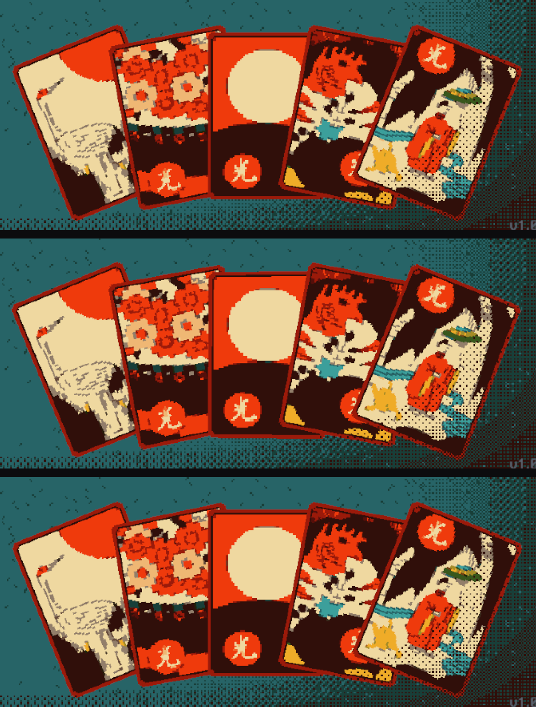

[← 목록](../README.md)

# 타이틀 화투 부채에 판의 패 움직임 입히기 계획

## Context

사용자 요청(2026-11-08): "타이틀 화면에 앞장으로 보이는 패들에 메인 게임 패 애니메이션 효과 적용하자."
사용자는 판의 효과 세 가지 중 둘을 골랐다.
- 숨쉬기 기울기: 판 손패의 아이들 워블. 3D 기울기에 원근 셰이더가 붙는다.
- 마우스 따라 기울기: 판의 포인터 틸트.
- 고르지 않은 것: 커서 강조(확대·튕김)는 넣지 않는다.

지금 타이틀 부채 5장은 정지한 월드 SpriteRenderer다. 장마다 배경·그림·테두리 세 층이 형제로 같은 자리·같은 Z 회전에 놓인다(`AgentScripts/BakeTitleScreen.cs` `FanCard`, 부모 없음). 기본 머티리얼(Sprite-Lit-Default)을 쓰고, 콜라이더와 Physics2DRaycaster는 없다.

판(`Assets/Scripts/Presentation/Board/CardView.cs`)의 사정은 이렇다.
- 수식: 아이들 워블은 `IdleTiltDegrees`(:3155-3186)다. `tiltX = A·sin θ`, `tiltY = A·cos θ`, `θ = (t/period + phase)·2π`이고 phase는 `id·0.618 % 1`이다.
- 포인터 목표는 `(clamp(off.y·perUnit, ±max), clamp(−off.x·perUnit, ±max))`(:2814-2826)이고, 반감기로 따라간다(:2782-2792).
- 적용: `Tilt` 자식 회전과 셰이더 `_CardTilt`(MaterialPropertyBlock, 도/40) 둘에 같은 각을 준다. 배경·테두리 층도 같은 값을 받는다(:3042-3149). 셰이더는 `Resources/Shaders/CardTiltParallax`이고, 피벗이 카드 가운데라고 가정한다.
- 값: `TurnBeatBudget.FollowProfile.Reaction`이 SSOT다. 손패 진폭 6°, 주기 4/0.7 ≈ 5.71초, 포인터 30/단위·최대 30°·반감기 ≈ 0.025초, 시차 0.25.
- 수식은 CardView 사설 메서드에 묶여 있다. UI 사본(`UICardReaction`)이 같은 수식을 따로 갖는다.

## 설계 결정

| # | 결정 |
|---|---|
| D1 | 새 순수 정적 `Presentation/Cards/CardTiltMath`에 CardView 수식 셋을 그대로 옮겨 적는다. `IdleTilt(time, period, phase01, amplitude)`, `PointerTiltTarget(offset, perUnit, max)`, `SmoothToward(current, target, halfLife, dt)`다. 이번에는 타이틀만 쓴다(아래 트레이드오프) |
| D2 | 새 `Presentation/Title/TitleFanMotion` 하나가 부채 다섯 장을 몬다. 직렬화 필드는 장마다 `{Background, Art, Edge}` 구조체 배열과 `_camera`다. 휴지 회전은 `Awake`에서 그림 층의 회전을 읽어 둔다 |
| D3 | 틱은 타이틀 관례를 따른다(`TitleLampFlicker`·`TitleSpriteFlipbook`). `Update`가 `Advance(min(unscaledDeltaTime, 0.1), 포인터 월드 좌표?)`를 부른다. `Advance`는 internal이라 시험이 직접 부른다 |
| D4 | 적용은 판과 같다. 세 층 transform 회전을 `휴지 회전 × Euler(tiltX, tiltY, 0)`으로 둔다(세 층 모두 가운데 피벗·같은 자리). MPB는 `_CardTilt = 각/40`, `_CardTiltParallaxStrength = 시차 × localScale.x`로 세 층에 같은 값을 준다 |
| D5 | 셰이더 계약의 주인은 CardView로 둔다. `TiltMaterial`·`CardTiltPropertyId`·`CardTiltParallaxStrengthPropertyId`·`ShaderTiltDegreesPerUnit`을 private에서 internal로만 바꾼다. 같은 어셈블리다. `Awake`가 세 층의 `sharedMaterial`을 그 머티리얼로 바꾼다. 셰이더가 없으면 머티리얼은 그대로 두고 회전만 한다(판과 같다) |
| D6 | 값은 `Resources.Load<TurnBeatBudget>(TurnBeatBudget.ResourcesPath).FollowProfile.Reaction`에서 한 번 읽는다. 손패 진폭, 주기, 포인터 셋, 시차다. 자산이 없으면 경고 1회 뒤 정지 상태로 둔다 |
| D7 | 포인터는 `Mouse.current`(Input System, 이미 참조 중)에서 읽는다. 카메라로 월드 좌표를 얻고 휴지 프레임의 카드 로컬로 바꿔, 카드 크기(그림 rect / PPU)로 나눈 오프셋을 만든다. 맨 위 카드(배열 뒤쪽)부터 `|x|,|y| ≤ 0.5`인 첫 장만 그 오프셋을 받는다. 나머지 장의 목표는 0이다. 판이 레이캐스트 맨 위 한 장만 기울이는 것과 같다. 콜라이더와 레이캐스터는 더하지 않는다 |
| D8 | 위상은 장 순번 × 0.618 % 1이다(판의 InstanceId 대신 결정적인 값). 커서 강조(확대·튕김·워블 감쇠)는 넣지 않는다 |
| D9 | 굽기: `BakeTitleScreen.BakeMotion`(:308-343)에 `FanMotion` 오브젝트와 `TitleFanMotion`을 붙이고, 다섯 장의 세 층과 카메라를 배선한다. 기존 레이어 위치·순서는 바꾸지 않는다 |

## 구현 카드 (순서대로, 카드마다 커밋 1, 구현/시험 분리)

| 카드 | 담당 (구현 / 시험) | 편집 | 시험·뮤테이션 |
|---|---|---|---|
| **F1** 수식·컴포넌트 | Ava / Sonny | ★`Presentation/Cards/CardTiltMath.cs`, ★`Presentation/Title/TitleFanMotion.cs`, `Presentation/Board/CardView.cs`(접근자 넷 private → internal만) | `CardTiltMathTests`(EditMode): t=0·위상 0이면 (0, A), 4분의 1 주기면 (A, 0), 크기 ≤ A, 포인터 목표 클램프·부호, 반감기 한 번에 절반. `TitleFanMotionTests`(EditMode, 메모리 스프라이트): 겹친 두 장 중 맨 위만 기운다, 카드 밖이면 목표 0, 한 장의 세 층 회전과 MPB 값이 같다, 휴지 Z 회전이 보존된다. 뮤테이션: sin/cos 뒤바꿈, 맨 위 대신 맨 아래 선택, 테두리 층 MPB 누락 |
| **F2** 굽기·씬 | Ava / 코디네이터 프로브 | `AgentScripts/BakeTitleScreen.cs`(`BakeMotion`), 굽기 2회 → `Assets/Scenes/TitleScene.unity` | 2회차 바뀐 자취 0건. 아래 종단 프로브 |

F1은 굽기 전이라 씬에서 아무것도 하지 않는다. 그래서 따로 커밋해도 컴파일과 화면이 그대로다.

## 검증

- 카드마다 `recompile` → 라이브 픽스처 → `ddtest.sh` + `playmode_batch.sh` → 뮤테이션(사본) → 커밋.
- 종단 프로브(F2 뒤, 라이브 에디터 Play 모드 캡처)
  1. 움직임: 1.4초 간격 캡처 두 장의 차이가 부채 영역 안에만 있다(램프·연기 애니메이션 영역은 제외하고 비교한다).
  2. 정렬: 확대 캡처에서 테두리·배경이 그림과 어긋나지 않는다. 세 층이 같은 각을 받는다.
  3. 포인터: eval로 `Advance(0.2, 둘째 장 위 좌표)`를 부르면 둘째 장만 기운다(겹친 첫째 장은 그대로).
  4. 꺼진 쪽 다른 픽셀 0: 진폭을 0으로 둔 프레임이 지금 타이틀과 픽셀이 같다(시차 셰이더는 각 0에서 기본 렌더와 같다).
- 회귀 영역: 메뉴 입력·선택 복원(TitleView), 확인 창, 패 더미·칩(바뀐 것 0).

## 트레이드오프

같은 수식이 셋이 된다(CardView, UICardReaction, CardTiltMath). 이번에는 타이틀만 `CardTiltMath`를 쓴다. CardView와 UICardReaction을 옮기는 일은 행동 보존 리팩토링이라 시험이 먼저 필요하다. 지금 CardView 수식을 지키는 시험이 없어서 별도 작업으로 남긴다.

## 위험

| 위험 | 완화 |
|---|---|
| 픽셀 아트를 3D로 기울이면 표본이 흔들려 반짝인다 | 판이 이미 같은 방식이다. 부채도 이미 Z 회전 중이다. 캡처로 확인하고 거슬리면 진폭만 낮춘다(값은 판과 공유하므로 사용자 결정) |
| 부채가 겹쳐 아래 장이 위 장 가장자리를 뚫고 보인다 | sortingOrder가 순서를 정하므로 3D 기울기와 무관하다. 프로브 2에서 확인한다 |
| 타이틀에 마우스가 없거나(패드) 배치 실행 | `Mouse.current == null`이면 포인터 없음으로 처리하고 워블만 돈다 |
| CardView 접근자 공개가 다른 코드를 부른다 | private → internal만 바꾸고 동작은 같다. grep으로 새 사용처가 타이틀뿐임을 확인한다 |

## 진행 (2026-11-08 완료, 미푸시)

| 카드 | 커밋 (Double Down) | 검증 |
|---|---|---|
| F1 수식·컴포넌트 | `8858b6e` | EditMode 2207 → 2231, PlayMode 223, 뮤테이션 5/5 사망(sin/cos 뒤바꿈, 맨 아래 장 선택, 테두리 층 누락, 포인터 부호, 스무딩 없음) |
| F2 굽기·씬 | `c5ef08b` | 2회차 굽기 바뀐 자취 0건, EditMode 2231, PlayMode 223, 종단 프로브(아래) |

위에서부터 정지(진폭 0), 숨쉬기 기울기, 둘째 장에만 포인터를 둔 상태다(Play 모드 캡처).

- 움직임: 1.4초 간격 두 프레임의 차이가 화면 아래쪽에서는 부채 영역 안(x 633~1235)에만 있다. 장마다 각 크기가 6°이고 위상이 다르다.
- 정렬: 테두리·배경이 그림과 함께 돈다. 세 층이 같은 회전과 같은 `_CardTilt`를 받는다.
- 포인터: 둘째 장 위(첫째 장과 겹치고 셋째 장 밖)에 두면 둘째 장만 (6.22°, 6.60°)이고 나머지 넷은 0이다.
- 꺼진 쪽: 진폭 0 프레임의 부채 영역이 F2 이전 기준선과 같다(아래쪽 차이 10픽셀은 메뉴 글자 색이다). 머티리얼을 틸트 셰이더로 바꿔도 정지 화면은 그대로다.
- 굽기 도구 변경은 계획보다 컸다(122줄). 배열 원소 배선 헬퍼와 층 이름 규칙 필드가 들어갔다.

### 남은 것

- 같은 수식의 세 사본(CardView, UICardReaction, CardTiltMath) 통합은 별도 작업이다. CardView 수식을 지키는 시험부터 필요하다.
- 실제 마우스로 움직여 보는 확인은 사용자 몫이다. 프로브는 `Advance`를 직접 불러 포인터를 흉내 냈다.
