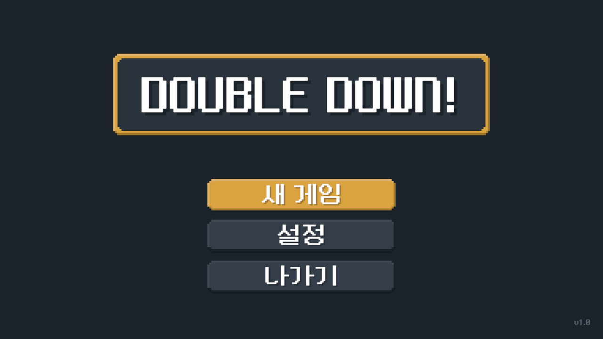
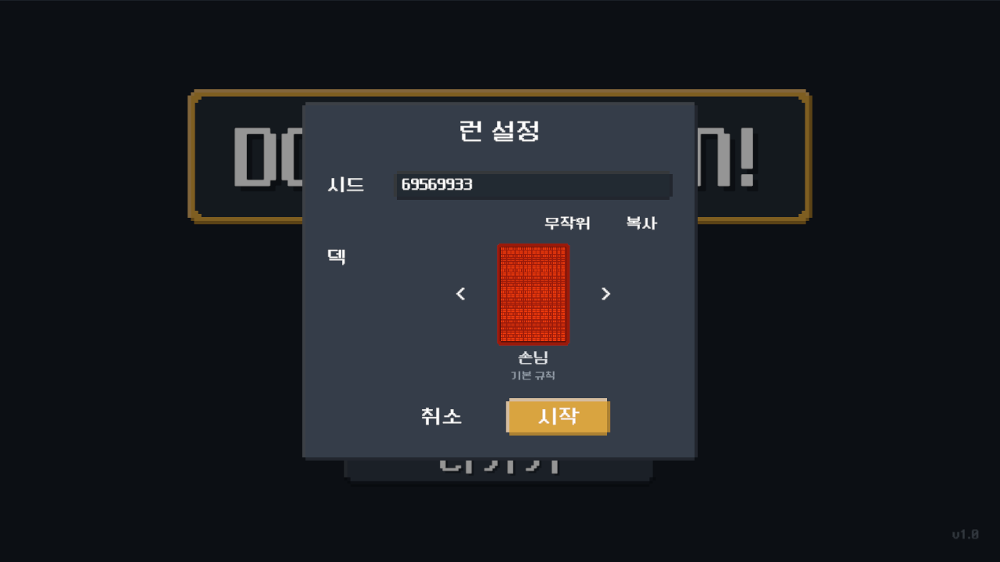
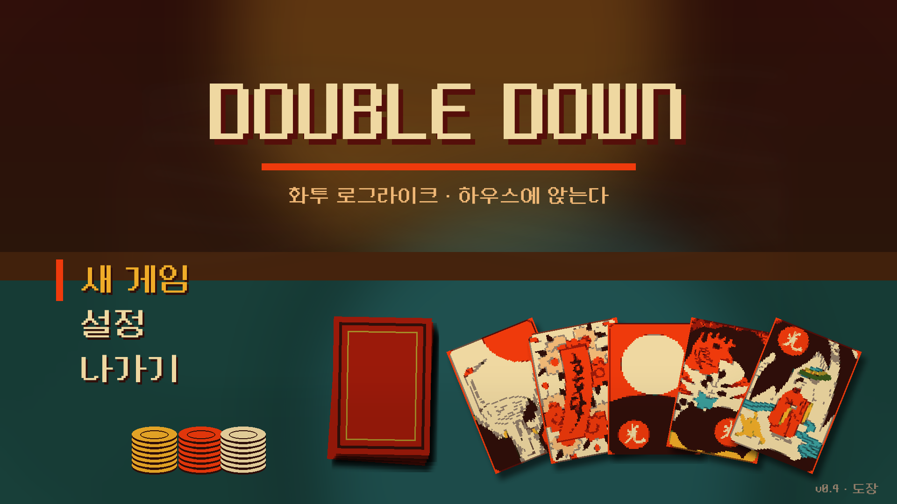
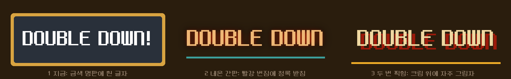
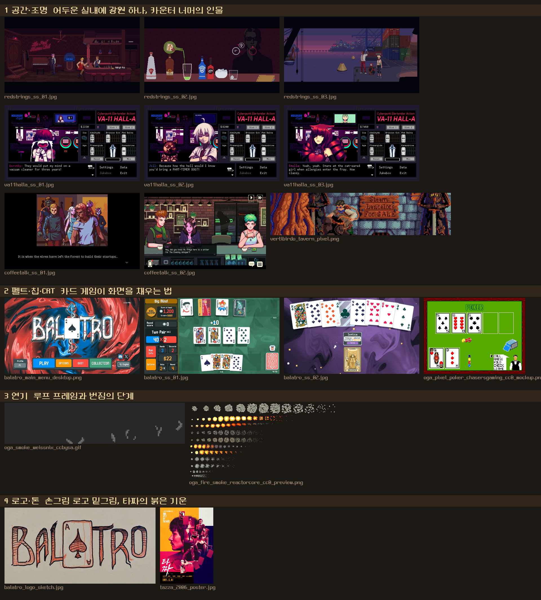
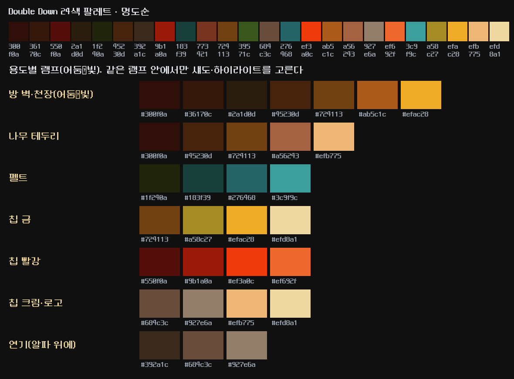

[← 목록](../README.md)

# Double Down 타이틀 씬 연구: 잘 만든 게임처럼 보이려면

2026-10-24. 사용자 질문 "타이틀 씬을 잘 만든 게임처럼 보이게 하려면"에 대한 조사와 제안이다. 코드는 바꾸지 않았다.
현재 화면은 라이브 에디터로 찍었고, 시안은 실제 에셋(화투 48장, 픽셀 폰트, 24색 팔레트)만으로 그렸다.

## 0. 한 장 요약

- 지금 타이틀은 "메뉴"이지 "장면"이 아니다. 게임이 무엇인지 말하는 요소가 글자 `DOUBLE DOWN!` 하나뿐이다.
- 잘 만든 타이틀은 공통으로 넷을 한다. ① 첫 3초에 게임을 보여 준다 ② 한 장의 장면이 느리게 움직인다 ③ 로고가 서체가 아니라 사물이다 ④ 소리가 있다.
- 권장 방향은 「하우스 테이블」이다. 백열등 아래 펠트 위에 화투와 칩이 놓인 장면 하나를 세우고, 그 위에 로고와 메뉴를 얹는다(§5 시안 A).
- 가장 큰 공백은 소리다. 프로젝트에 오디오 파일이 한 개도 없다(`Assets/**/*.wav|ogg|mp3` 0건). 타이틀 테마 하나가 화면 어떤 손질보다 인상을 크게 바꾼다.

## 1. 지금 타이틀 (2026-10-24 캡처)

| 요소 | 지금 | 근거 |
|---|---|---|
| 배경 | 단색 `#1B2129`. 그림·움직임 0 | `TitleScene.unity` `Image_Backdrop`, 스프라이트 없음 |
| 로고 | 금색 명판(`#D9A441`) 안에 픽셀 폰트 180pt 흰 글자 `DOUBLE DOWN!` | `Panel_TitlePlaque`·`Text_Title` |
| 메뉴 | 600×100 버튼 셋(새 게임·설정·나가기). 설정은 로그만 찍는다 | `TitleScene.cs:218` `설정 화면이 아직 없다` |
| 런 설정 | 시드 입력, 덱 캐러셀(뒷면 1장), 시작·취소 | `RunSetupView.prefab` |
| 전환 | 페이드 | `Loader.TransitionToAsync<MainScene>(TransitionStyle.Fade)` |
| 소리 | 없음(프로젝트 전체) | 오디오 자산 0건, `AudioSource` 참조 0건 |
| 색 | 전부 팔레트 밖(`#1B2129`·`#29303A`·`#343E4A`·`#D9A441`) | 팔레트 메모(2026-09-24) |

진단은 하나로 모인다. **이 화면은 "어떤 게임인가"를 말하지 않는다.** 화투도, 돈도, 하우스도 없다. 폰트와 명판만으로는 어느 픽셀 게임의 메뉴여도 같다.
작은 문제도 있다. 로고 폰트가 본문 폰트와 같아 로고가 "큰 글자"로 읽힌다. 느낌표가 게임 톤(누아르)보다 들뜬다. 버튼 셋의 크기가 같아 주행동이 색으로만 갈린다.

## 2. 잘 만든 타이틀이 공유하는 것

출처가 있는 것은 괄호에 적었다. 나머지는 사례를 보고 내가 정리한 판단이다.

1. **첫 3초에 게임을 보여 준다.** 타이틀은 플레이어가 받는 첫인상이고, 좋은 타이틀은 게임이 어떻게 느껴질지를 미리 전한다(Washington Post 「최고의 타이틀 화면」, 슈퍼 마리오 3는 버튼을 누르기 전에 게임 요소가 보인다).
   Balatro는 메뉴가 뜨기 전에 조커 한 장(Jimbo)이 화면 아래에서 올라오고, 로고의 A 자리가 스페이드 에이스다(Balatro 위키 「Main menu」). 메뉴 전에 **카드**부터 보인다.
2. **한 장의 장면이 느리게 움직인다.** Slay the Spire는 구름이 흐르고, Balatro는 배경 셰이더가 돈다. 움직임이 있어야 화면이 "살아 있다"고 읽힌다. 단 픽셀 아트는 움직임이 크고 빠르면 가장자리가 뭉개지므로 느리고 작게 둔다(연기·불빛 깜빡임·카드 한 장 미끄러짐 정도).
   역효과도 기록돼 있다. Balatro의 회전 배경은 멀미를 호소한 플레이어가 있어 끄는 설정이 쓰인다(Steam 토론). 배경 모션은 반드시 끌 수 있어야 한다.
3. **로고는 서체가 아니라 사물이다.** Balatro의 로고는 A 하나를 카드로 바꾸고 CRT 곡면처럼 휘게 했다(위키, Crosley 분석). 우리 로고는 글자 한 줄이다. 글자 하나를 화투 한 장(광)이나 도장으로 바꾸는 것만으로 로고가 된다.
4. **메뉴는 셋에서 넷, 주행동 하나만 돋보인다.** 지금 구성(새 게임·설정·나가기)은 맞다. 다만 주행동은 색만이 아니라 자리·크기·선택 표식으로 갈라야 한다. 호버·선택·누름에 각각 반응(크기 1.03배, 소리, 색)이 있어야 "잘 만든" 느낌이 난다. 키보드 선택 표식도 같은 규칙을 탄다.
5. **소리가 첫인상의 절반이다.** 테마 한 곡과 호버·확정 효과음 둘이면 된다. 지금은 0건이라 이 항목이 비용 대비 효과가 가장 크다.
6. **전환이 장면의 일부다.** 페이드는 가장 약한 전환이다. "새 게임"을 누르면 테이블로 줌 인하거나 카드가 덮이며 판으로 넘어가면 타이틀과 판이 한 공간으로 이어진다. 런 설정 팝업도 테이블 위의 물건(시드 쪽지, 덱 뒷면)으로 세우면 같은 공간에 머문다.
7. **절제.** 요소는 다섯을 넘기지 않는다. 장면 하나, 로고, 메뉴, 버전, 그리고 움직이는 것 하나. Balatro도 로고·조커·버튼 줄이 전부다.

## 3. 사례 표

| 게임 | 타이틀이 하는 것 | 우리가 가져올 것 | 근거 |
|---|---|---|---|
| Balatro | 조커가 올라온 뒤 메뉴, 에이스가 든 로고, 회전 배경, 테마 음악, CRT 곡면 | 카드부터 보이기, 로고 안의 사물, 배경 모션은 끄기 가능 | 위키·Crosley·Steam 토론 |
| Slay the Spire | 그림 한 장 위에 구름이 흐른다 | 장면 하나 + 느린 움직임 | Steam 토론(구름 애니메이션 언급) |
| Inscryption | 평범한 메뉴로 위장했다가 세계로 끌어들인다. 막마다 메뉴 색이 바뀐다 | 타이틀이 세계의 일부라는 태도 | TV Tropes·비평 |
| 사용자 레퍼런스 | `Assets/Arts/Reference/`의 Balatro 캡처 2장(펠트·CRT·픽셀 UI) | 이미 이 방향을 보고 있다 | 저장소 |

Hades·Dead Cells는 검색에서 타이틀 설명을 확인하지 못해 표에서 뺐다.

## 4. Double Down 타이틀이 말해야 하는 것

세계관 정본(런 지형 §1, Glossary)에서 타이틀에 올릴 낱말을 고르면 넷이다.

| 낱말 | 화면 요소 | 자산 |
|---|---|---|
| 화투 | 앞면 부채(광·띠), 뒷면 더미 | `Assets/Arts/Sprites/Hwatu` 48장(70×98, 데모 파생 밑그림), 뒷면은 `.aseprite` |
| 하우스(뒷골목, 백열등, 담배 연기) | 어두운 흙빛 방, 위에서 떨어지는 따뜻한 빛, 느린 연기 | 팔레트 `#2a1d0d`·`#300f0a`·`#efac28`, 연기는 셰이더 또는 스프라이트 시트 |
| 돈(밑천·골드) | 칩 더미, 돈주머니 | HUD 칩·골드 아이콘 |
| 더블(욕심) | 로고의 "두 번 찍힘", 빨간 밑줄 | 폰트·팔레트만 |

## 5. 방향 제안

### 시안 A 「하우스 테이블」(권장)

백열등 아래 펠트 테이블. 왼쪽에 메뉴, 오른쪽에 화투 부채와 칩. 로고는 크림색 글자에 자주 그림자, 빨간 밑줄. 실제 에셋과 팔레트만 썼다(시안 생성 스크립트는 세션 스크래치패드 `title/mock.py`).
움직임은 셋만 둔다. 연기가 천천히 흐른다, 백열등이 아주 느리게 숨 쉰다(밝기 ±3%), 호버한 카드가 2px 뜬다. 새 게임을 누르면 테이블로 줌 인하며 판으로 간다.

| 장점 | 비용 |
|---|---|
| 판 화면(펠트·카드·칩)과 같은 공간이라 전환이 이어진다 | 배경 그림 1장(또는 레이어 3장: 방·빛·연기)을 그려야 한다 |
| 있는 에셋(화투·칩·폰트)으로 뼈대가 선다 | 연기 모션은 셰이더 또는 8프레임 시트 |
| 팔레트 안에서 끝난다 | 뒷면 스프라이트는 `.aseprite`라 UI용 PNG 내보내기 필요 |

### 시안 B 로고 처리 셋

① 지금의 금색 명판 ② 네온 간판(빨강 번짐, 청록 받침) ③ 두 번 찍힘(크림 위에 자주 그림자). "더블"을 글자로 말하는 것은 ③이다. ②는 하우스 간판으로 읽히지만 팔레트의 빨강(`#ef3a0c`) 하나로는 네온이 약하다.
어느 쪽이든 글자 하나를 사물로 바꾸는 것(O 자리에 칩, 또는 로고 옆에 도장 한 방)은 따로 결정할 수 있다.

### 선택지 C 다이제틱(화투방 문 앞)

메뉴 자체를 장면 안의 사물로 둔다(문패가 "새 게임", 간판이 "설정"). 세계관을 가장 강하게 말하지만 그림이 통째로 필요하고 설정 화면도 없는 지금은 과하다. 2막 이후 보스 연출과 함께 다시 본다.

## 6. 구현 지도 (결정 뒤)

| 요소 | 자리 | 방법 |
|---|---|---|
| 장면 레이어 | `TitleScene.unity` `Image_Backdrop` 자리에 방·빛·연기 3장 | 스프라이트 3장 + `CanvasGroup`. 캔버스는 1920×1080 기준, 높이 맞춤 |
| 연기·불빛 모션 | `TitleView`에 `MotionHandle` 2개 | LitMotion 루프(`unitask-async.md` 룰 7). 끄기 설정은 `PlayerPrefs` 하나 |
| 로고 | `Text_Title` 교체 | 시안 B ③이면 TMP 머티리얼(그림자)로 끝난다. 사물을 넣으면 스프라이트 1장 |
| 메뉴 피드백 | `TitleView` 버튼 셋 | `UICardReaction` 선례(상점 타일 펀치)로 호버 1.03배·누름 0.97배 |
| 소리 | 신설 | `AudioSource` 1개, 테마 1곡, 효과음 2개. 자산 0건이라 외주나 라이선스 음원이 먼저다 |
| 전환 | `TransitionStyle` | 줌 인은 `UIScreenFader` 옆에 `Zoom` 스타일 추가 |
| 색 이관 | 타이틀 UI 색 | 팔레트 대응표를 먼저 보인다(메모 규칙) |

시험은 `TitleView` 생명주기(모션 핸들이 `OnDestroy`에서 끊기는가, 끄기 설정이 모션을 안 만드는가)와 프리팹 배선 명부다.

## 7. 결정해 주실 것

1. 방향: **시안 A로 결정(2026-10-24).** 그림은 사용자가 Aseprite로 직접 찍는다. C는 보류. 레퍼런스는 §10이다.
2. 로고: 시안 B ①·②·③ 중 하나. 글자 하나를 사물(칩·광·도장)로 바꿀지.
3. 소리: 테마 곡을 어디서 구할지(직접·외주·라이선스). 이것이 없으면 화면만 고쳐도 "잘 만든" 느낌이 반만 난다.
4. 느낌표: `DOUBLE DOWN!`의 `!`를 뗄지.
5. 설정 화면: 타이틀 단장과 함께 최소 설정(소리 크기·배경 모션 끄기·언어)을 세울지.

## 8. 다음 단계

그림은 사용자가 §9 명세와 §10 보드를 보고 찍는다. Ava는 같은 치수의 단색 자리채움을 먼저 만들어 씬을 라이브 에디터 명령으로 굽고, 그림이 오면 같은 이름으로 덮는다. 모션·피드백은 Ava 코드, 시험은 Sonny다.
소리는 자산이 먼저라 별도 트랙이다.

## 9. 이미지 자산 명세 (시안 A 기준, 2026-10-24)

따로 그린 이미지가 있어야 "장면"이 된다. 지금 시안의 빛·연기·칩은 코드로 그린 자리채움이라 배치만 보여 준다.

**치수 규칙.** 타이틀의 모든 그림은 한 정수 배율을 쓴다. 권장은 ×3이다. 원본 캔버스 640×360이 1920×1080에 정확히 맞고, 화투 70×98이 210×294로 서서 부채가 읽힌다.
더 거친 픽셀감을 원하면 ×4(원본 480×270, 화투 280×392)다. 어느 쪽이든 배경·소품·글자가 같은 배율이어야 한다(카드 아트 메모의 텍셀 동등 규칙).
색은 24색 팔레트 인덱스로 그린다. 반투명이 필요한 층(빛무리·연기)만 알파를 쓴다.

### 9-1. 필수 (이것 없이는 장면이 서지 않는다)

| # | 자산 | 원본 치수(×3 기준) | 내용 | 비고 |
|---|---|---|---|---|
| 1 | 방 배경 `Title_Room` | 640×360, 1장 | 뒷골목 하우스의 벽과 천장. 위 중앙에 백열등 줄과 전구. 어두운 흙빛(`#300f0a`·`#2a1d0d`·`#36170c`) | 화면 위 55%만 보이고 아래는 테이블이 덮는다 |
| 2 | 테이블 `Title_Table` | 640×200, 1장 | 펠트(`#183f39`, 중앙은 `#276468`로 밝게)와 나무 테두리(`#45230d`) | 판 화면의 펠트가 단색이라 이 그림이 첫 펠트 그림이 된다 |
| 3 | 빛무리 `Title_LampGlow` | 200×200, 1장, 알파 | 전구 아래로 퍼지는 따뜻한 빛. 디더링한 원 | UI Image는 가산 합성을 못 하므로 알파 겹침으로 그린다. 깜빡임은 코드(알파 ±3%) |
| 4 | 연기 `Title_Smoke` | 160×120, 8~12프레임 시트, 알파 | 느리게 올라가는 담배 연기 한 줄기 | 프레임 0.12초, 루프. 끄기 설정이 이 층을 숨긴다 |
| 5 | 로고 `Title_Logo` | 약 420×100, 1장 | 손으로 찍은 글자 `DOUBLE DOWN`. 크림 `#efd8a1` 위에 자주 `#550f0a` 그림자. 느낌표는 결정 4 | 폰트 글자가 아니라 그림이어야 로고로 읽힌다 |
| 6 | 칩 더미 `Title_ChipStack_{Gold,Red,Cream}` | 40×64, 3장 | 옆에서 본 칩 더미. 금 `#efac28`, 빨강 `#ef3a0c`, 크림 `#efd8a1` | HUD 칩 아이콘은 서드파티 팩이라 톤이 다르다 |
| 7 | 메뉴 선택 표식 `Title_Cursor` | 12×28, 1장 | 고른 항목 왼쪽의 빨간 막대 또는 작은 화투 끝 | 코드 사각형으로 대체 가능 |

화투 앞면 5장과 뒷면 더미는 **새로 그리지 않는다.** `Assets/Arts/Sprites/Hwatu`(70×98)와 `Card/BasicCardBack.aseprite`(72×108)를 Unity가 그대로 읽는다.

### 9-2. 권장 (있으면 "살아 있는" 느낌이 난다)

| # | 자산 | 원본 치수 | 내용 |
|---|---|---|---|
| 8 | 전구 깜빡임 `Title_Lamp` | 24×40, 2~3프레임 | 필라멘트 밝기 두 단계. 빛무리 알파와 같이 움직인다 |
| 9 | 시드 쪽지 `Title_SeedNote` | 220×150 | 런 설정 팝업을 테이블 위 메모지로 세운다. 시드 입력칸이 이 위에 선다 |
| 10 | 로고 사물 `Title_LogoStamp` | 48×48 | 로고 옆에 찍히는 도장 한 방(빨강 `#9b1a0a`). 2프레임(찍히기 전·후) |
| 11 | 테이블 비네트 `Title_Vignette` | 640×360, 알파 | 가장자리를 어둡게. 코드로도 되지만 디더링 질감은 그림이 낫다 |

### 9-3. 선택 (비용이 크다. 보류 권장)

| # | 자산 | 내용 | 비용 |
|---|---|---|---|
| 12 | 인물 | 테이블 건너편 타짜의 손이나 뒷모습 실루엣 | 캐릭터 아트 기준이 아직 없다 |
| 13 | 네온 로고 | 시안 B ②용 2프레임(켜짐·깜빡) | 팔레트 빨강 하나로는 네온이 약하다 |

### 9-4. 제작 규칙

- 파일은 `Assets/Arts/Sprites/Title/`에 둔다. `.aseprite` 원본은 사용자가 커밋한다(아트 커밋 경계 메모).
- 임포트는 Point 필터, 압축 없음, PPU는 기존 화투와 같게. 배율이 섞이면 가장자리가 뭉개진다.
- 층 순서는 아래부터 방 → 테이블 → 뒷면 더미 → 칩 → 화투 부채 → 빛무리 → 연기 → 비네트 → 로고 → 메뉴다.
- 자리를 먼저 보려면 Ava가 팔레트 색 단색 자리채움(같은 치수)을 코드로 만들어 씬에 꽂을 수 있다. 그림이 오면 같은 이름으로 덮는다.
- 소리는 그림과 별도 트랙이다. 테마 1곡, 호버·확정 효과음 2개.

## 10. 레퍼런스 보드 (시안 A, 2026-10-24)

원본 17장은 Double Down `Assets/Arts/Reference/Title/`에 있고, 파일별 출처와 조건은 그 폴더의 `README.md`가 든다.
픽셀을 베끼지 않는다. 가져오는 것은 구도, 명도 단계, 소품 밀도 셋이다. 색은 팔레트 램프로 바꾼다.

램프 그림은 24색을 명도순으로 늘어놓고 펠트·나무·빛·연기·칩의 단계를 뽑은 것이다. 그릴 때 옆에 둔다.

### 10-1. 공간·조명 (방 배경 `Title_Room`, 빛무리, 인물 실루엣)

| 파일 | 볼 것 |
|---|---|
| `redstrings_ss_01` | 바 전경. 네온 간판 하나가 공간의 이름을 말하고, 벽은 비우고 소품 서넛만 밝다. 방 배경의 밀도 기준 |
| `redstrings_ss_02` | 전경의 병·잔은 크고 밝고, 카운터 너머 인물은 실루엣이다. 전경 칩·부채와 후경 타짜(§9-3)의 두 단 깊이 |
| `redstrings_ss_03` | 저녁 하늘의 디더링 띠와 역광 실루엣. 빛무리 가장자리를 디더링으로 푸는 방식 |
| `va11halla_ss_01~03` | 패널마다 테두리가 있는 CRT풍 UI, 어두운 바 배경 위 초상. 런 설정 쪽지와 설정 화면(결정 5)의 패널 질감 |
| `coffeetalk_ss_01` | 한쪽에서 오는 따뜻한 주황 조명이 인물군을 가른다. 전구 빛이 테이블 한쪽만 밝히는 구도 |
| `coffeetalk_ss_02` | 선반 소품이 빼곡한 카운터. 소품 밀도의 상한이다. 우리는 이보다 비운다 |
| `vertibirdo_tavern_pixel` | 돌벽·나무결의 디더링과 그림으로 찍은 간판 글자. 나무 테두리(`#45230d`) 질감과 로고의 참고 |

### 10-2. 펠트·칩·CRT (테이블 `Title_Table`, 칩 더미, 로고 크기)

| 파일 | 볼 것 |
|---|---|
| `balatro_main_menu_desktop` | 로고가 화면 40%를 차지하고 글자 하나가 카드(에이스)로 바뀐다(결정 2). 메뉴는 아래 가로 띠, 버튼마다 색이 다르다 |
| `balatro_ss_01` | 단색 펠트 위 흰 카드라 대비가 크다. 우리 화투는 바탕이 어두워 펠트 `#183f39` 위에서 약할 수 있다. 부채 뒤 빛무리로 분리한다 |
| `balatro_ss_02` | 배경 색만 보라로 바꿔도 판의 톤이 바뀐다. 배경 한 층이 장면의 기분을 정한다 |
| `oga_pixel_poker_…_mockup` | 256×192에서 칩이 2~3px 디스크 묶음으로 읽힌다. `Title_ChipStack` 40×64은 넉넉하다. 빨간 나무 테두리도 같은 구도 |

### 10-3. 연기 (`Title_Smoke`)

| 파일 | 볼 것 |
|---|---|
| `oga_smoke_weissnix_ccbysa` | 32×32 10프레임. 한 줄기가 뭉쳤다 흩어지는 궤적이고 프레임 간 차이가 작아 느린 루프에 맞다. 160×120에서는 세로로 늘인 궤적으로 본다 |
| `oga_fire_smoke_reactorcore_cc0_preview` | 회색 연기 행이 진한 덩어리에서 성긴 점으로 사라지는 순서를 보여 준다. 디더링이 빠지는 단계의 참고 |

### 10-4. 로고·톤 (`Title_Logo`, 전체 색)

| 파일 | 볼 것 |
|---|---|
| `balatro_logo_sketch` | 종이 연필 밑그림. 획이 울퉁불퉁하고 A 자리에 스페이드가 선다. 로고는 폰트가 아니라 그림이라는 §9-1 5번의 근거. 종이에 먼저 긋고 찍는다 |
| `tazza_2006_poster` | 빨강·자주·크림 세 톤이 팔레트 `#9b1a0a`·`#550f0a`·`#efd8a1` 축과 같다. 옆얼굴과 글자가 한 색면에 겹친다. 타이틀 전체 톤의 기준 |

## 출처

- [Balatro Wiki, Main menu](https://balatrowiki.org/w/Main_menu): 조커 등장, 에이스가 든 로고, 테마 음악, 버튼 구성
- [Blake Crosley, Balatro: Juicy Feedback](https://blakecrosley.com/guides/design/balatro): CRT 곡면 로고, 피드백 층
- [Steam 토론, Balatro 배경 멀미](https://steamcommunity.com/app/2379780/discussions/0/4346606879522405614): 회전 배경 불만
- [Washington Post, Best video game title screens](https://www.washingtonpost.com/video-games/interactive/2021/best-video-game-title-screens/): 첫인상, 슈퍼 마리오 3(검색 요약으로만 확인, 본문은 접근 제한)
- [Steam 토론, Slay the Spire 타이틀](https://steamcommunity.com/app/646570/discussions/0/1692659135900855658/): 구름 애니메이션 언급
- [TV Tropes, Inscryption](https://tvtropes.org/pmwiki/pmwiki.php/VideoGame/Inscryption): 메뉴 위장, 막별 색
- 레퍼런스 파일별 출처·조건: Double Down `Assets/Arts/Reference/Title/README.md`
- 저장소: `Assets/Scenes/TitleScene.unity`, `Assets/Scripts/Boot/Scenes/TitleScene.cs`, `Assets/Scripts/Presentation/Title/TitleView.cs`, `Assets/Arts/Reference/`
