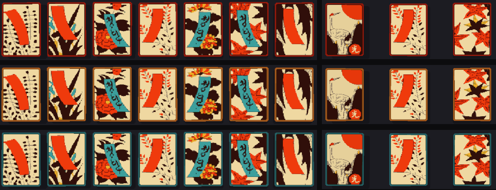

[← 목록](../README.md)

# UI 화투 칸에 덱 테두리 입히기 계획

## Context

화투 48장에서 그림 자체 테두리를 지웠다(Double Down `1116403`). 판과 타이틀 부채는 덱 스킨(배경·테두리)을 따로 깔아 그리므로 기본 테두리 한 겹이 되었다. 반면 UI 네 칸은 그림만 그려서 외곽선이 사라졌다.
사용자 지시(2026-11-08): **"UI 칸들은 현재 덱에 따라 테두리 색을 맞춰야 돼."**

대상 칸 네 개 (전부 `CardSpriteTable.TryGetFront`로 그림을 받는다):

| 칸 | 그림을 넣는 곳 |
|---|---|
| 상점 칩 팩 카드 `ShopChipOfferCard` | `ShopView.ResolveCardFace` (`ShopView.cs:1268`) |
| 도장 후보 `ShopStampTargetCard`, 도장 칸 `ShopStampSlotCard` | `ShopView.FaceOf` (`:1514`) → `ShopStampPanel.Open` 대리자 |
| 족보 힌트 `JokboHintView` (칸 = Image 자체) | `JokboHintView.ApplySprite` (`:134`), 표는 `Resources.Load` |

덱 스킨의 SSOT는 `CardSpriteTable.SkinFor(deckId)` → `CardSkin{Background, Border, Back}`다. 세 덱이 배경을 공유하고 테두리·뒷면만 다르다(Basic 1·Mulju 2·Dangol 3). 지금 이 값을 받는 것은 판(`MatchRuntime.Create`)뿐이다.

## 설계 결정

**테두리를 별도 Image로 얹지 않고, 배경·그림·테두리를 한 장의 스프라이트로 합성한다.**
상점 세 칸은 그림 Image 하나에 세 가지가 걸려 있어서 따로 얹은 테두리가 따라가지 못한다.
- 버튼 ColorTint: 못 살 때 회색 + 알파 0.5
- 호버 기울기 셰이더(정점 단계 가짜 원근): `UICardReaction._target`에만 걸린다
- 족보 힌트의 어둡게 칠하기(0.35)

합성 스프라이트는 이 셋을 그대로 받고, 프리팹·굽기 도구·`UICardReaction`을 고치지 않는다. 족보 시험의 "보이는 Image 수" 단언도 깨지지 않는다.

| # | 결정 |
|---|---|
| D1 | 새 `Presentation/Cards/FramedCardFaces`(생성자 `CardSpriteTable`, `CardSkin`). `TryGet(int definitionId, out Sprite)`가 처음 요청 때 합성하고 장별로 캐시한다. `Dispose`가 만든 텍스처·스프라이트를 치운다 |
| D2 | 합성 규칙은 판과 같은 순서(배경 → 그림 → 테두리). 캔버스는 테두리 크기(70×98)이고, 각 층은 텍셀 단위로 가운데 정렬한다(배경 66×94는 (2,2)). 순수 함수(`Color32[]`)로 떼어 EditMode에서 검증한다. 배치 EditMode는 `-nographics`라 GPU 경로는 쓰지 않는다 |
| D3 | 원본 픽셀은 텍스처마다 `GetPixels32()`를 한 번 불러 `textureRect`로 색인한다. 배경·테두리 버퍼는 48장이 공유한다. 출력은 `RGBA32`, sRGB, 밉 없음, Point, Clamp, 피벗 가운데, PPU는 그림 PPU다 |
| D4 | 합성하지 않고 그림 그대로 돌려주는 경우(경고 1회): 원본을 읽을 수 없음, `sprite.packed`, 그림이 캔버스보다 큼, 크기 차가 홀수. `skin.Border == null`이면 경고 없이 그림 그대로(판이 그 층을 끄는 것과 같다). `Dispose` 뒤에도 그림 그대로 |
| D5 | 원본 읽기: 화투 48장은 `CardSpriteTableGenerator`가 임포터를 강제할 때 `isReadable = true`를 함께 강제한다. 배경과 테두리 3장은 `AgentScripts/BakeCardFrontSkin.cs`가 `m_TextureImporterSettings.m_IsReadable`(SerializedObject, 패키지 인스펙터와 같은 경로)을 강제한다. 뒷면·발광은 그대로 둔다 |
| D6 | 알파 섞기는 CPU의 sRGB 바이트 연산이다. 프로젝트는 Linear라 반투명 픽셀이 있으면 판과 달라진다. 지금 배경·테두리 알파는 0/255뿐이다(측정). 이 조건을 시험으로 고정한다 |
| D7 | 전달: `MainScene`이 씬마다 하나 만든다(`PreloadCardSpritesAsync` 끝, `_spriteTable.SkinFor(PendingRunConfig.Value.DeckId)`). `ShopView.BindCardFaces`와 `MatchView.BindCardFaces`로 넘기고, `OnDestroy`에서 풀고 `Dispose`한다. 두 뷰는 `UIService`가 씬을 넘겨 살려 두므로, 씬에 들어올 때마다 다시 묶는다 |
| D8 | 족보 경로: `MatchView.BindCardFaces` → `JokboTracker._cardFaces`(`BuildPool`·`Clear`와 무관). 호버 때 인자로 내려보낸다: `line.ShowElements(cards, faces)` → `_elements.Show(cards, faces)` → `ApplySprite(cell, id, faces)` |
| D9 | 묶이지 않은 뷰는 지금의 `TryGetFront` 경로 그대로다. 경고를 내지 않는다(`ShopViewPrefabWiringTests`가 경고 0을 요구) |

## 구현 카드 (순서대로, 카드마다 커밋 1, 구현/시험 분리)

| 카드 | 담당 (구현 / 시험) | 편집 | 시험·뮤테이션 |
|---|---|---|---|
| **K1** 원본 읽기 허용 | Jarvis / Sonny | `Editor/DataPipeline/CardSpriteTableGenerator.cs`(`Force(importer.isReadable, true, …)`), `AgentScripts/BakeCardFrontSkin.cs`(4장만 읽기 허용). 코디네이터가 두 도구를 라이브 에디터로 돌려 `.meta` 52개를 같은 커밋에 넣는다 | `CardFaceSpriteTests` 48장 루프와 `CardSkinTests` 출하 표 시험에 게이트 추가: `isReadable && !packed`, 배경·테두리 알파 ∈ {0,255}. 뮤테이션은 사본 `.meta`에서 `isReadable: 0` → 빨간불 |
| **K2** 합성기 | Jarvis / Sonny | ★`Presentation/Cards/FramedCardFaces.cs` | `FramedCardFacesTests`(EditMode, 메모리 텍스처): 층 순서, 배경 (2,2) 인셋, 테두리 투명부에 그림이 보임, 캐시 동일성, 대체 경로 넷(읽기 불가·packed·홀수 차·Border null), `Dispose` 뒤 그림 반환. 뮤테이션: 테두리 층 생략, 그림을 테두리 위로, 인셋 0 |
| **K3** 상점 | Ava / Sonny | `Hud/ShopView.cs`(`BindCardFaces`, `ResolveCardFace`·`FaceOf`가 묶인 합성기를 먼저 쓴다) | `ShopChipOfferDisplayTests`에 묶인 경로 1건(칩 팩 그림이 합성본), 도장 패널 1건. 기존 동일성 시험은 그대로 초록. 뮤테이션: 묶인 합성기 무시 |
| **K4** 족보 | Ava / Sonny | `Hud/MatchView.cs`, `Hud/JokboTracker.cs`, `Hud/JokboTrackerLine.cs`, `Hud/JokboHintView.cs` | `JokboHintHoverTests`에 묶인 경로 1건(칸 스프라이트가 합성본, 보유 여부 색은 그대로). 뮤테이션: 호버 때 합성기를 안 넘김 |
| **K5** 배선 | Jarvis / 코디네이터 프로브 | `Boot/Scenes/MainScene.cs`(생성 `:376` 뒤, 묶기 `:537`·`:661` 뒤, 풀기·`Dispose` `OnDestroy`) | 자동 시험 없음(`MainScene`을 세우는 통합 시험이 없다). 아래 종단 프로브로 검증 |

직렬화 이유: `MainScene`은 허브 파일이고 K3·K4의 받는 쪽이 먼저 있어야 컴파일된다. K3과 K4는 파일이 겹치지 않지만 커밋 경계를 지키려고 순서대로 간다.

## 검증

- 카드마다 `recompile` → 라이브 픽스처 → `ddtest.sh`(EditMode 전량, 2179 + 신규) + `playmode_batch.sh`(223) → 뮤테이션(사본) → 커밋.
- **종단 프로브 (K5 뒤, 라이브 에디터 캡처)**: 시드 `00000380`, 덱 1·2·3 각각.
  - 화면 셋을 찍는다: 칩 팩 카드(`Button_BuyChipPack`), 도장 패널(`Button_BuyStamp`), 판 중반 족보 줄 호버.
  - 합격 기준 ① 칸 바깥 1~2픽셀 색이 그 덱 테두리 색이다. 덱마다 다르고, 판의 같은 덱 테두리와 같다.
  - 합격 기준 ② 못 사는 카드는 테두리까지 함께 흐려진다.
  - 합격 기준 ③ 호버 기울기에서 테두리가 그림과 어긋나지 않는다.
  - 합격 기준 ④ 족보 힌트의 안 가진 카드는 테두리까지 어둡다.
  - 타이틀 → 다른 덱으로 새 런을 시작해 다시 묶이는지 확인한다.
- 회귀 영역: 판 손패·바닥, 타이틀 부채(바뀐 것 0), `ShopView.prefab`·`Item_Jokbo.prefab` 변경 0.

## 위험

| 위험 | 완화 |
|---|---|
| 나중에 아틀라스를 만들거나 재임포트로 읽기 허용이 꺼지면 조용히 그림만 나온다 | K1 게이트가 출하 자산의 `isReadable && !packed`를 시험으로 고정한다 |
| 반투명 테두리를 새로 그리면 CPU 섞기가 판과 달라진다 | 알파 0/255 게이트. 깨지면 선형 섞기로 바꾼다 |
| 판(층)과 UI(합성)의 그리는 방식이 둘이다 | 스킨 데이터 SSOT는 `SkinFor` 하나다. 층 순서는 합성기 문서에 판 `CardView`를 가리켜 적는다 |
| 족보 힌트 칸이 20×28이라 테두리가 1px 남짓으로 줄어든다 | 캡처로 확인한다. 안 보이면 사용자에게 보고한다(칸 크기는 범위 밖) |
| `Presentation` 안에서 `Application`이 네임스페이스로 해석된다 | `UnityEngine.Application.isPlaying`으로 적는다(`CardChipLabel.cs:252` 선례) |

## 진행 (2026-11-08 완료, 미푸시)

| 카드 | 커밋 (Double Down) | 검증 |
|---|---|---|
| K1 원본 읽기 허용 | `c462ac8` | 도구 실행 전 게이트 빨간불 → 실행 뒤 초록. 2회차 강제 0건. `.meta` 52개는 `isReadable` 한 줄씩만 바뀜. EditMode 2179 → 2181, 뮤테이션 2/2 사망 |
| K2 합성기 | `b86baa7` | EditMode 2181 → 2202, PlayMode 223, 뮤테이션 5/5 사망 |
| K3 상점 | `6bc726c` | EditMode 2202 → 2205, PlayMode 223, 뮤테이션 3/3 사망 |
| K4 족보 | `29ed014` | EditMode 2205 → 2207, PlayMode 223, 뮤테이션 3/3 사망 |
| K5 배선 | `32b9903` | EditMode 2207, PlayMode 223, 종단 프로브(아래) |

위에서부터 기본·물주·단골 덱이다. 왼쪽은 도장 패널, 오른쪽은 칩 팩 카드다(시드 `00000380`).

- 테두리 색: 도장 패널 첫 카드의 왼쪽 가장자리를 픽셀로 쟀다. 바깥 → 안쪽이 기본 `9B1A0A` → `300F0A` 계열, 물주 `AB5C1C` → `724113`, 단골 `276468` → `183F39`다. 덱 자산의 테두리 고리 색과 같다. 칩 팩 첫 카드는 선택 강조(0.96)가 테두리까지 함께 칠해져 4% 어둡다.
- 족보 힌트: `MainScene`·트래커·상점이 같은 합성기 인스턴스를 든다(리플렉션). 칸 스프라이트 이름이 `101_m01_gwang+MuljuCardEdge`처럼 덱 테두리 합성본이다. 보유 칸 색은 1.00, 미보유 칸은 0.35다.
- 재묶음: 기본 덱 런에서 패배 → 타이틀 → 단골 덱 런으로 넘어갔다. 트래커와 상점이 새 씬의 합성기를 들고, 칸이 `DangolCardEdge` 합성본이다. 콘솔 오류는 0건이다.
- 작업 중 계약 조정 2건이 있었다.
  - 합성기는 `textureRect` 대신 `sprite.rect`로 색인한다. `Sprite.Create`의 Tight 스프라이트는 `textureRect`가 소수(69.85×97.85)라 홀수 차로 오판한다.
  - 시험 작성자의 권고에 따라 `Dispose`는 텍스처까지 치운다.

### 확인하지 못한 것

- 족보 힌트의 화면 캡처: 판 시작에는 `Panel_JokboTracker`가 꺼져 있고 화면 밖(x −157)에 있다. 그래서 20×28 칸에서 테두리가 어떻게 보이는지는 눈으로 확인하지 못했다. 스프라이트 배정과 색은 위처럼 확인했다.
- 호버 기울기와 못 사는 카드의 흐려짐: 합성본이 그림 Image 한 장이라 구조상 함께 움직인다. 캡처로 따로 확인하지는 않았다.
